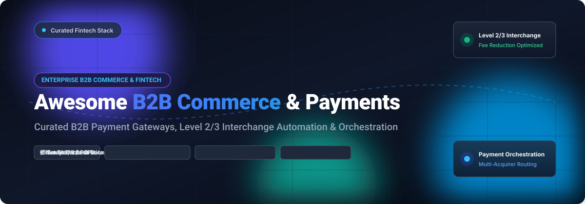

<p align="center">
  
</p>

# Awesome B2B Commerce & Payment Processing Solutions 🚀💳

<p align="left">
  <a href="https://github.com/ishandutta2007/Awesome-Awesome-Awesome"></a><a href="https://discord.gg/jc4xtF58Ve"></a>
  <a href="https://github.com/ishandutta2007/Awesome-Awesome-Awesome"></a>
  <a href="https://opensource.org/licenses/MIT"></a>
  <a href="https://github.com/ishandutta2007/Awesome-B2B-Commerce-Payment-Processing/pulls"></a>
  <a href="https://github.com/ishandutta2007/Awesome-B2B-Commerce-Payment-Processing"></a>
  <a href="https://github.com/ishandutta2007"></a>
</p>

> 🌟 A curated, battle-tested list of leading **B2B Commerce Platforms**, **Payment Processing Gateways**, **Payment Orchestration Engines**, and **Level 2/3 Interchange Automation** systems (spanning both enterprise SaaS products and self-hosted open-source GitHub projects).

---

## 📊 Sector Overview & Market Dynamics

The global B2B payments market is estimated at **$1.65 trillion to $1.70 trillion** in transaction volume (powering an overarching B2B digital commerce ecosystem exceeding **$25 trillion**) and is expanding at a **10.5%–15.5% CAGR** as enterprises aggressively phase out manual paper checks, batch wire transfers, and disconnected invoicing systems. 

The sector remains **moderately to highly fragmented** rather than a "winner-take-all" landscape: divergent regional rails (ACH, SEPA, Faster Payments), differing enterprise ERP integrations (SAP, Oracle, NetSuite), high ticket sizes requiring trade credit (Net-30/60/90 terms), and complex card processing rules (Level 2/Level 3 interchange qualification) prevent single-vendor hegemony, creating substantial market share for specialized B2B gateways, payment orchestration middleware, and modular headless commerce engines.

---

## 📑 Table of Contents 🧭

- [📊 Sector Overview & Market Dynamics](#-sector-overview--market-dynamics)
- [💳 SaaS & Hosted Payment Platforms](#-saashosted-payment-platforms)
  - [SaaS Pricing, Company Scale & Limits Matrix](#-saas-pricing-company-scale--limits-matrix)
  - [Detailed SaaS Profiles](#-detailed-saas-profiles)
- [💻 Open-Source GitHub Projects](#-open-source-github-projects)
  - [Open-Source Solutions Ranked by Stars](#-open-source-solutions-ranked-by-stars)
  - [Detailed Open-Source Profiles](#-detailed-open-source-profiles)
- [🏛 Architecture Comparison: Gateway vs Orchestrator vs Commerce Engine](#-architecture-comparison-gateway-vs-orchestrator-vs-commerce-engine)
- [⭐ Star History](#-star-history)
- [💖 Support & Sponsorship](#-support--sponsorship)
- [🤝 How to Contribute](#-how-to-contribute)
- [⚖️ Disclaimer & Compliance](#-disclaimer--compliance)

---

## 💳 SaaS/Hosted Payment Platforms

### 📈 SaaS Pricing, Company Scale & Limits Matrix

*Sorted by Company Scale (Valuation / Market Capitalization / Annual Revenue in descending order).*

| Provider | Company Scale (Valuation / Revenue) | Starting Pricing (Specific Tiers) | Free Tier / Free Trial Limits | Level 2/3 Optimization | Primary Focus / Best For |
| :--- | :--- | :--- | :--- | :---: | :--- |
| **[Authorize.Net](https://www.authorize.net/)** (Visa) | **$780B+ Market Cap** (Parent: Visa Inc.; ~$45.9B annual revenue; $200B+ TPV) | **$25.00/month** gateway fee + **$0.10** per transaction + **$0.10** daily batch fee (or **2.49% + $0.20** with merchant account) | **Free Developer Sandbox Account** (unlimited duration; test accounts only, $0 real processing) | Supported | Legacy ERP & accounting system compatibility with independent merchant accounts |
| **[Stripe](https://stripe.com/)** | **$159B Valuation** (~$6.8B annual net revenue) | **2.9% + $0.30** per successful card charge; Invoicing starts at **0.4%** per paid invoice (Starter); Billing starts at **0.7%** on recurring volume | **Free Developer Testmode** (unlimited duration; 25 free invoices per month on Stripe Invoicing Starter before 0.4% fee applies) | Eligible commercial cards | Developer-first API payments, international recurring billing, and digital checkout workflows |
| **[Square](https://squareup.com/)** (Block, Inc.) | **$24.5B Annual Revenue** (Parent: Block, Inc.; $40B+ market cap) | **2.9% + $0.30** per online transaction (In-person card-present: **2.6% + $0.10**; Square Invoices Plus tier: **$20.00/month**) | **Free Forever Plan** (Square Free Invoices has $0 monthly fee, unlimited invoices, estimates, and contracts; standard 2.9% + $0.30 processing charged upon customer payment; 30-day free trial on Invoices Plus) | Standard commercial cards | Small-to-midsize B2B trade services, field service contractors, and mixed omnichannel sales |
| **[Adyen](https://www.adyen.com/)** | **€29.0B (~$31B) Market Cap** (€1.6B+ net revenue) | **€0.11 ($0.12) processing fee** + payment method interchange cost (Interchange++ starting pricing model) | **Free Test Account** (unlimited access to staging platform and full API capabilities; zero live production processing without signed corporate contract) | Enterprise interchange optimization | Global omnichannel enterprises needing unified international acquiring |
| **[PayPal B2B](https://www.paypal.com/)** | **$47.0B Market Cap** (~$30.4B annual revenue) | **2.99% + $0.49** per standard online transaction; **3.49% + $0.49** for custom checkout invoices; **1.90% to 3.49%** for commercial trade | **Free Business Account** ($0 monthly account maintenance fee, free digital invoice creation; standard processing fees apply strictly per settled transaction) | Standard processing | Trusted digital wallet adoption, invoice factoring, and instant brand recognition |
| **[Checkout.com](https://www.checkout.com/)** | **$12.0B Valuation** (~$750M net revenue) | **€0.02 to €0.05 gateway fee** + Interchange++ rates (starting tier tailored to enterprise merchant underwriting) | **Free Sandbox Test Environment** (unlimited API testing, webhooks, and simulated payments; live processing requires sales review and underwriting) | Automated Level 2/3 pass-through | High-growth digital enterprises and cross-border multi-currency transactions |
| **[Mollie](https://www.mollie.com/)** | **€1.95B (~$2.1B) Valuation** (€147M net revenue) | **€0.25 fixed fee** (iDEAL) / **1.8% + €0.25** (European Consumer Cards) / **2.8% + €0.25** (Commercial & International Cards); $0 monthly fee | **Free Forever Account** ($0 monthly subscription, zero signup charges; fees are 100% pay-per-successful-transaction with no minimum quotas) | Varies by method | European B2B businesses needing seamless regional payment methods (iDEAL, Bancontact, SEPA) |
| **[Helcim](https://www.helcim.com/)** | **$250M CAD Valuation** (~$150M ARR) | **Interchange + 0.15% to 0.30% + $0.15 to $0.25** per transaction (rates automatically decrease as monthly processing volume tiers increase) | **Free Forever Merchant Account** (Zero monthly recurring subscription fees, zero cancellation fees, free virtual terminal, free invoicing; pay-per-transaction only) | Automatic automated line-item submission (L2/L3) | B2B distributors & suppliers taking high-ticket corporate and government purchasing cards |

---

### 🔍 Detailed SaaS Profiles

#### [Authorize.Net](https://www.authorize.net/)
- **Category**: Enterprise payment gateway (Visa Inc. subsidiary).
- **Pricing Breakdown**: Gateway-only setup costs **$25.00/month** plus **$0.10 per transaction** and a **$0.10 daily batch fee**. All-in-one payment processing plan costs **$25.00/month** + **2.49% + $0.20 per transaction**.
- **Free Tier / Trial Limits**: Unlimited free sandbox environment with virtual merchant terminals and mock payment generation.
- **Enterprise Scale**: Backed by Visa Inc. ($780B+ market cap) and processes over $200B in annualized gross payments.
- **Best Suited For**: Companies running classic ERPs (SAP, Microsoft Dynamics, QuickBooks) with separate pre-negotiated acquiring banks.

#### [Stripe](https://stripe.com/)
- **Category**: Full-stack payment infrastructure and developer APIs.
- **Pricing Breakdown**: Card processing starts at **2.9% + $0.30** for standard domestic cards (+1% for international cards). Stripe Invoicing Starter is free for the first 25 invoices each month, then **0.4% per paid invoice** (Plus tier at 0.5%). Stripe Billing is **0.7% on recurring volume**.
- **Free Tier / Trial Limits**: Free developer sandbox testmode (unlimited simulated requests, webhooks, test cards).
- **Enterprise Scale**: Valued at $159 billion with ~$6.8 billion in net revenue.
- **Best Suited For**: Technology companies, modern SaaS vendors, and engineering-centric B2B marketplaces.

#### [Square](https://squareup.com/)
- **Category**: Omnichannel commerce, invoicing, and POS ecosystem.
- **Pricing Breakdown**: Standard digital invoicing charges **2.9% + $0.30** per payment. Free software tier ($0/mo); **Square Invoices Plus** costs **$20.00/month** for multi-package quotes, custom invoice fields, and automatic milestone reminders.
- **Free Tier / Trial Limits**: Free forever tier for baseline invoices (no monthly cost; pay transaction fees only when invoices are paid). 30-day free trial on Square Invoices Plus.
- **Enterprise Scale**: Parent company Block, Inc. generates $24.5B+ in annual revenues.
- **Best Suited For**: Wholesale trades, contractors, and merchants needing unified physical and digital payment tools.

#### [Adyen](https://www.adyen.com/)
- **Category**: End-to-end global acquiring and financial technology platform.
- **Pricing Breakdown**: Standard **€0.11 ($0.12) fixed transaction fee** plus Interchange++ pass-through rates customized to business profile and currency volume.
- **Free Tier / Trial Limits**: Unlimited test staging account for API evaluation; zero live production processing without formal corporate contract.
- **Enterprise Scale**: Traded on Euronext Amsterdam with a ~€29.0B market cap.
- **Best Suited For**: Multinational corporations handling cross-border commerce with localized omnichannel payment methods.

#### [PayPal B2B](https://www.paypal.com/)
- **Category**: Global payment gateway and trade commerce network.
- **Pricing Breakdown**: Online card checkout starts at **2.59% + $0.49**; standard PayPal digital payments at **3.49% + $0.49**; QR/In-person transactions at **2.29% + $0.09**.
- **Free Tier / Trial Limits**: Free business account creation with zero recurring maintenance fees; pay only per completed sale.
- **Enterprise Scale**: Publicly traded on NASDAQ with a ~$47.0B market capitalization.
- **Best Suited For**: B2B vendors looking for instant brand familiarity, integrated dispute resolution, and trade financing.

#### [Checkout.com](https://www.checkout.com/)
- **Category**: Cloud-based direct acquiring enterprise processor.
- **Pricing Breakdown**: Interchange++ bespoke schedules starting from **€0.02 to €0.05 per API call** depending on contractual volume commits.
- **Free Tier / Trial Limits**: Full-featured developer sandbox environment with mock acquiring and automated webhook triggers.
- **Enterprise Scale**: Private valuation of $12.0 billion with ~$750M in annual net revenue.
- **Best Suited For**: High-throughput digital merchants requiring deep payment routing telemetry and low latency.

#### [Mollie](https://www.mollie.com/)
- **Category**: European payment service provider.
- **Pricing Breakdown**: **€0.25** for iDEAL, **1.8% + €0.25** for EEA credit cards, **2.8% + €0.25** for commercial/non-EEA cards, and **€0.35** for SEPA Bank Transfer.
- **Free Tier / Trial Limits**: Free forever account with zero monthly software costs or setup minimums; merchants pay solely on successful orders.
- **Enterprise Scale**: Valued at €1.95 billion following strategic combinations.
- **Best Suited For**: European B2B merchants targeting customers across Germany, France, the Netherlands, and the UK.

#### [Helcim](https://www.helcim.com/)
- **Category**: Transparent interchange-plus merchant processor with automated Level 2/Level 3 optimization.
- **Pricing Breakdown**: **Interchange + 0.30% + $0.25** (for <$50K/month), scaling automatically down to **Interchange + 0.15% + $0.15** for volume over $500K/month. Takes an automated share of realized L2/L3 interchange fee savings.
- **Free Tier / Trial Limits**: Free forever merchant account: $0/month software fees, $0 PCI compliance fees, $0 cancellation fees, with free virtual terminal, online store, and recurring invoice builder.
- **Enterprise Scale**: Valued at $250M CAD with $150M+ ARR.
- **Best Suited For**: Wholesalers, equipment suppliers, and government vendors capturing corporate purchasing cards.

---

## 💻 Open-Source GitHub Projects

### 🌟 Open-Source Solutions Ranked by Stars

*Sorted in descending order by GitHub_Stars.*

| Project | Stars_Badge (Links to Stargazers) | Primary Tech Stack | Core Architecture & Focus | License |
| :--- | :---: | :--- | :--- | :--- |
| **[Hyperswitch](https://github.com/juspay/hyperswitch)** | [](https://github.com/juspay/hyperswitch/stargazers) | Rust, ReScript, TypeScript | **Payment Orchestration Engine**: High-throughput routing across 100+ gateways, PCI card vault, and smart retries. | Apache 2.0 |
| **[Medusa](https://github.com/medusajs/medusa)** | [](https://github.com/medusajs/medusa/stargazers) | Node.js, TypeScript, PostgreSQL | **Composable Headless Commerce**: Modular commerce engine with extensible customer groupings, carts, and payment handlers. | MIT |
| **[Bagisto](https://github.com/bagisto/bagisto)** | [](https://github.com/bagisto/bagisto/stargazers) | PHP, Laravel, Vue.js | **Modular B2B E-Commerce & Marketplace**: Multi-channel catalogs, quotation systems, and corporate multi-warehouse stock management. | MIT |
| **[Saleor](https://github.com/saleor/saleor)** | [](https://github.com/saleor/saleor/stargazers) | Python, Django, GraphQL | **GraphQL Headless Commerce**: Multi-channel and multi-warehouse e-commerce backbone optimized for custom frontends. | BSD-3-Clause |
| **[Spree Commerce](https://github.com/spree/spree)** | [](https://github.com/spree/spree/stargazers) | Ruby on Rails, Hotwire | **Battle-Tested B2B Storefront**: Native wholesale portals, spreadsheet order entry, price lists, and multi-vendor suites. | AGPL-3.0 |
| **[Sylius](https://github.com/Sylius/Sylius)** | [](https://github.com/Sylius/Sylius/stargazers) | PHP, Symfony, Doctrine | **Enterprise Tailored Commerce**: Highly extensible framework built on clean Symfony components with robust B2B suite. | MIT |
| **[BTCPay Server](https://github.com/btcpayserver/btcpayserver)** | [](https://github.com/btcpayserver/btcpayserver/stargazers) | C#, .NET, ASP.NET Core | **Self-Hosted Crypto Processor**: Direct non-custodial Bitcoin and Lightning payment processor with zero third-party intermediaries. | MIT |
| **[Kill Bill](https://github.com/killbill/killbill)** | [](https://github.com/killbill/killbill/stargazers) | Java, MySQL/PostgreSQL | **Open-Source Billing & Payments**: Enterprise recurring billing engine, invoicing, dunning management, and payment gateway routing. | Apache 2.0 |
| **[Solidus](https://github.com/solidusio/solidus)** | [](https://github.com/solidusio/solidus/stargazers) | Ruby on Rails, Turbo | **Scalable Rails Commerce**: Community-governed fork of Spree optimized for enterprise customizations and complex checkout rules. | BSD-3-Clause |
| **[GrandNode 2](https://github.com/grandnode/grandnode2)** | [](https://github.com/grandnode/grandnode2/stargazers) | .NET Core, C#, MongoDB, Vue.js | **Cross-Platform .NET B2B Suite**: Customer tier pricing, corporate account management, and native ERP connectors. | GPLv3 |
| **[Vendure](https://github.com/vendure-ecommerce/vendure)** | [](https://github.com/vendure-ecommerce/vendure/stargazers) | TypeScript, Node.js, NestJS, GraphQL | **Developer-First Headless Platform**: Plugin-oriented architecture with introspectable GraphQL schema for composable checkouts. | MIT |

---

### 📦 Detailed Open-Source Profiles

#### 1. [Hyperswitch](https://github.com/juspay/hyperswitch)
- **GitHub Repository**: [`juspay/hyperswitch`](https://github.com/juspay/hyperswitch)
- **License**: Apache 2.0
- **Technology Stack**: Rust (High-performance core), ReScript & TypeScript (Checkout SDKs)
- **Description**: Enterprise-grade payment orchestration engine created by Juspay (proven on 300M+ transactions daily). Unifies over 100+ payment gateways (Stripe, Adyen, PayPal, Worldpay) behind a single standardized API.
- **B2B Capabilities**: Automated intelligent payment routing, smart fallback retries to uplift corporate card authorization rates, centralized PCI DSS-compliant card vault, and cross-processor transaction analytics.

#### 2. [Medusa](https://github.com/medusajs/medusa)
- **GitHub Repository**: [`medusajs/medusa`](https://github.com/medusajs/medusa)
- **License**: MIT
- **Technology Stack**: Node.js, TypeScript, PostgreSQL, Redis
- **Description**: Composable headless commerce engine engineered as a developer-first alternative to legacy commerce platforms.
- **B2B Capabilities**: Modular architecture allowing independent scaling of product catalogs, multi-currency price lists, customer groups with custom price overrides, and pluggable payment providers.

#### 3. [Bagisto](https://github.com/bagisto/bagisto)
- **GitHub Repository**: [`bagisto/bagisto`](https://github.com/bagisto/bagisto)
- **License**: MIT
- **Technology Stack**: PHP 8.x, Laravel, Vue.js, Tailwind CSS
- **Description**: Modern, modular e-commerce framework with extensive out-of-the-box B2B functionality and multi-inventory capabilities.
- **B2B Capabilities**: Wholesale ordering grids, custom quote and RFQ management, tier pricing per buyer organization, sales representative order booking, and multi-warehouse inventory allocation.

#### 4. [Saleor](https://github.com/saleor/saleor)
- **GitHub Repository**: [`saleor/saleor`](https://github.com/saleor/saleor)
- **License**: BSD-3-Clause
- **Technology Stack**: Python, Django, GraphQL, PostgreSQL
- **Description**: High-throughput GraphQL-first commerce core designed to serve global brands through composable frontends (Next.js, Remix, Gatsby).
- **B2B Capabilities**: Multi-warehouse stock tracking, discrete multi-channel sales environments, asynchronous webhooks for ERP/CRM synchronization, and granular customer checkout permissions.

#### 5. [Spree Commerce](https://github.com/spree/spree)
- **GitHub Repository**: [`spree/spree`](https://github.com/spree/spree)
- **License**: AGPL-3.0
- **Technology Stack**: Ruby on Rails, Turbo, Hotwire
- **Description**: One of the most mature and widely adopted open-source commerce platforms worldwide, powering massive product catalogs.
- **B2B Capabilities**: Built-in wholesale portal with bulk spreadsheet ordering, contract price lists mapped to buyer groups, multi-vendor marketplace orchestration, and split-order fulfillment.

#### 6. [Sylius](https://github.com/Sylius/Sylius)
- **GitHub Repository**: [`Sylius/Sylius`](https://github.com/Sylius/Sylius)
- **License**: MIT
- **Technology Stack**: PHP, Symfony, Doctrine, MySQL
- **Description**: Developer-friendly commerce framework built strictly on clean architecture and Symfony best practices.
- **B2B Capabilities**: Comprehensive B2B suite featuring corporate customer accounts, multiple buyer roles with spending thresholds, custom approval hierarchies, and flexible tax calculation plugins.

#### 7. [BTCPay Server](https://github.com/btcpayserver/btcpayserver)
- **GitHub Repository**: [`btcpayserver/btcpayserver`](https://github.com/btcpayserver/btcpayserver)
- **License**: MIT
- **Technology Stack**: C#, .NET, ASP.NET Core
- **Description**: Self-hosted, non-custodial cryptocurrency invoice and payment processing server with no fees and no third-party custody.
- **B2B Capabilities**: Automated payment-request creation, multi-store architecture, permissioned user roles, pull payments for supplier disbursements, and direct accounting ledger exports.

#### 8. [Kill Bill](https://github.com/killbill/killbill)
- **GitHub Repository**: [`killbill/killbill`](https://github.com/killbill/killbill)
- **License**: Apache 2.0
- **Technology Stack**: Java, OSGi plugin architecture, MySQL/PostgreSQL
- **Description**: Robust enterprise subscription billing and payments platform designed to manage complex multi-tier enterprise contracts.
- **B2B Capabilities**: Advanced recurring billing logic (anniversary, calendar-aligned), automated dunning workflows, financial invoice generation with line-item tax details, and pluggable payment gateway routing.

#### 9. [Solidus](https://github.com/solidusio/solidus)
- **GitHub Repository**: [`solidusio/solidus`](https://github.com/solidusio/solidus)
- **License**: BSD-3-Clause
- **Technology Stack**: Ruby on Rails, Stimulus, Tailwind CSS
- **Description**: Highly customizable e-commerce framework maintained by a passionate community for businesses with demanding operational needs.
- **B2B Capabilities**: Flexible promotions engine, order state machines, multi-store frontends, and direct integration with corporate payment processors (Stripe, Braintree, Adyen).

#### 10. [GrandNode 2](https://github.com/grandnode/grandnode2)
- **GitHub Repository**: [`grandnode/grandnode2`](https://github.com/grandnode/grandnode2)
- **License**: GPLv3
- **Technology Stack**: ASP.NET Core, C#, MongoDB, Vue.js
- **Description**: Cross-platform open-source e-commerce platform specifically developed for .NET enterprise shops.
- **B2B Capabilities**: Native B2B features including customer groupings, quote requests, wholesale tier pricing tables, sales rep assignments, and direct REST APIs for enterprise Microsoft ERPs.

#### 11. [Vendure](https://github.com/vendure-ecommerce/vendure)
- **GitHub Repository**: [`vendure-ecommerce/vendure`](https://github.com/vendure-ecommerce/vendure)
- **License**: MIT
- **Technology Stack**: Node.js, NestJS, TypeScript, GraphQL, SQLite / PostgreSQL / MySQL
- **Description**: Modern headless commerce framework crafted specifically for TypeScript developers who need an extensible backend core.
- **B2B Capabilities**: Strongly typed GraphQL schema, custom plugin lifecycle events for invoice credit limits, dynamic pricing strategies, and compatibility with modern AI agent workflows.

---

## 🏛 Architecture Comparison: Gateway vs Orchestrator vs Commerce Engine

```
+-------------------------------------------------------------------+
|                        B2B Buyer Checkouts                        |
|       (Buyer Portals / ERP PunchOut / Wholesale Invoicing)        |
+-------------------------------------------------------------------+
                                  |
                                  v
+-------------------------------------------------------------------+
|                  B2B Commerce Storefront Platform                 |
|       (Spree / Medusa / Bagisto / Saleor / Sylius / GrandNode)    |
|   * Customer Tiers    * Wholesale Price Books   * Approval Flows  |
+-------------------------------------------------------------------+
                                  |
                                  v
+-------------------------------------------------------------------+
|                     Payment Orchestration Layer                   |
|                        (Hyperswitch / Kill Bill)                  |
|   * Smart Routing     * PCI Card Vault          * Retries & Dunning|
+-------------------------------------------------------------------+
                                  |
                                  v
+-------------------------------------------------------------------+
|                    Commercial Payment Processors                  |
|      (Stripe / Helcim / Adyen / Checkout.com / Authorize.Net)     |
|   * Merchant Underwriting   * Settlement Rails   * Level 2/3 Data |
+-------------------------------------------------------------------+
```

### 🧠 Structural Roles
1. **Commercial Payment Processors (Stripe, Helcim, Adyen, Authorize.Net)**: Act as merchant account providers and acquirers. They settle fiat funds into bank accounts, underwrite risk, manage interchange compliance, and submit Level 2/Level 3 invoice data to Visa/Mastercard.
2. **Payment Orchestrators (Hyperswitch, Kill Bill)**: Middleware routing solutions that sit between checkout applications and multiple acquiring banks. They do not hold merchant funds, but provide failover routing, retry logic, tokenization vaults, and subscription dunning.
3. **B2B Commerce Platforms (Spree, Medusa, Bagisto, GrandNode)**: Provide buyer authentication, catalogs, inventory reservation, wholesale quotes, order state machines, and shopping cart logic.

---

## 📈 Star History

[](https://star-history.dera.page/#ishandutta2007/Awesome-B2B-Commerce-Payment-Processing&type=date&legend=top-left)

---

## 💖 Support & Sponsorship

If this curated fintech resource saves your engineering or product team research hours, please consider supporting the project:

- ⭐ **Star this repository** to help others discover it across GitHub.
- 🍴 **Fork and contribute** updates or add new innovative tools.
- ☕ **Sponsor or buy a coffee**: Show your appreciation on the [GitHub Sponsor Dashboard](https://github.com/sponsors/ishandutta2007).

Thank you to all open-source maintainers, contributors, and developers pioneering better payment infrastructure! 🙌

---

## 🤝 How to Contribute

Contributions are warmly welcomed! To suggest a new tool or suggest updates:
1. Fork this repository.
2. Update `README.md` keeping formatting consistent with existing tables and profiles.
3. For SaaS products: include specific starting pricing tiers, company scale metrics, and exact free tier/trial limits.
4. For open-source projects: include the GitHub repository, tech stack, license, and stargazers badge.
5. Submit a descriptive Pull Request.

---

## ⚖️ Disclaimer & Compliance

- This repository is a community-curated directory compiled for educational and architectural research purposes. It does not constitute formal legal, financial, or interchange consulting.
- Payment systems accepting, processing, or storing payment card data must adhere strictly to **PCI DSS** standards. Self-hosting payment vaults shifts security verification and compliance liability to your engineering team.
- **Level 2 & Level 3 interchange fee reductions** require automated transmission of required line-item data (SKUs, tax IDs, invoice numbers) and apply exclusively to eligible corporate, commercial, fleet, and government cards.
